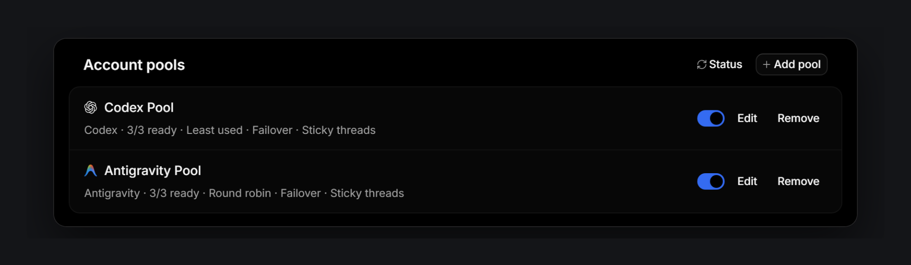
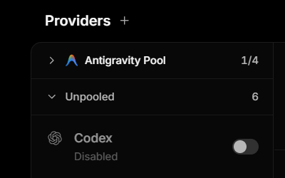

<h1 align="center">T3 Code Pool</h1>

  Fork of <a href="https://github.com/pingdotgg/t3code">T3 Code</a> with multi-account pools, automatic rate-limit failover, and device sync.

  
  
  
  
  

  <strong>Drop-in replacement on desktop:</strong> just download and install over official T3 Code — no need to uninstall. All chats, projects, settings, and signed-in accounts carry over automatically. (<a href="#install-notes">Platform notes</a>)

  <a href="#how-it-works">How it works</a> |
  <a href="#device-sync">Device sync</a> |
  <a href="#install">Install</a> |
  <a href="#quick-setup">Quick setup</a> |
  <a href="./POOL.md">Technical notes</a>

  

## Why this fork exists

If you use multiple Codex, Antigravity, or Claude accounts, hitting a usage limit mid-thread means stopping, switching profiles by hand, and starting over.

T3 Code Pool groups accounts of the same provider into one pool. You pick one model in the chat selector, and T3 Code handles account selection and rate limits in the background. It runs on your own signed-in accounts, with no proxy or token reselling.

  

## How it works

Each pool sits in front of two or more accounts of the same provider (Codex, Antigravity, Claude, and others).

- **Routing strategy.** Choose how new threads pick an account: **Least used**, **Earliest reset**, **Round robin**, or **Priority**.
- **Sticky threads.** A thread stays on the same account across turns so session state and context do not reset.
- **Auto-failover.** When an account hits a rate limit or quota error, it goes on cooldown and the turn automatically switches to the next ready account.
- **Clean picker & sidebar.** Pooled accounts collapse into an expandable group in **Settings / Providers** (with live ready/total counts) and appear as a single entry in the chat model picker across desktop, web, and mobile.

  

## Device sync

If you run T3 Code on more than one machine, set one server (such as a Linux VM or home server) as a **Hub** and connect your laptops or desktops as **Clients**.

- **Shared cooldowns.** When an account hits a limit on one machine, the other machines know immediately and skip it.
- **Encrypted vault.** Push pools and optional credentials from your main machine and pull them on another. Bundles are encrypted with AES-256-GCM before leaving your device.
- **Cross-OS safe.** Pulling between Windows, macOS, and Linux keeps local binary and config paths intact instead of overwriting them with paths from another OS.

  

## Install

Download `v0.1.11` directly or browse all files (including [`SHA256SUMS`](https://github.com/S0yora/t3code-pool/releases/download/v0.1.11/SHA256SUMS)) on [GitHub Releases](https://github.com/S0yora/t3code-pool/releases/latest):

| Platform                                                                                                | Downloads (`v0.1.11`)                                                                                                                                                                                                                                                                                                                                                                                                                                           |
| ------------------------------------------------------------------------------------------------------- | --------------------------------------------------------------------------------------------------------------------------------------------------------------------------------------------------------------------------------------------------------------------------------------------------------------------------------------------------------------------------------------------------------------------------------------------------------------- |
|   | [Installer x64 (.exe)](https://github.com/S0yora/t3code-pool/releases/download/v0.1.11/T3-Code-0.1.11-x64.exe) · [Installer arm64 (.exe)](https://github.com/S0yora/t3code-pool/releases/download/v0.1.11/T3-Code-0.1.11-arm64.exe) · [CLI x64 (.zip)](https://github.com/S0yora/t3code-pool/releases/download/v0.1.11/t3-0.1.11-win32-x64.zip) · [CLI arm64 (.zip)](https://github.com/S0yora/t3code-pool/releases/download/v0.1.11/t3-0.1.11-win32-arm64.zip) |
|                          | [Apple Silicon (.dmg)](https://github.com/S0yora/t3code-pool/releases/download/v0.1.11/T3-Code-0.1.11-arm64.dmg) · [Intel (.dmg)](https://github.com/S0yora/t3code-pool/releases/download/v0.1.11/T3-Code-0.1.11-x64.dmg) · [CLI arm64 (.tar.gz)](https://github.com/S0yora/t3code-pool/releases/download/v0.1.11/t3-0.1.11-darwin-arm64.tar.gz)                                                                                                                |
|                           | [AppImage x64](https://github.com/S0yora/t3code-pool/releases/download/v0.1.11/T3-Code-x86_64.AppImage) · [AppImage arm64](https://github.com/S0yora/t3code-pool/releases/download/v0.1.11/T3-Code-arm64.AppImage) · [CLI x64 (.tar.gz)](https://github.com/S0yora/t3code-pool/releases/download/v0.1.11/t3-0.1.11-linux-x64.tar.gz) · [CLI arm64 (.tar.gz)](https://github.com/S0yora/t3code-pool/releases/download/v0.1.11/t3-0.1.11-linux-arm64.tar.gz)      |
|  | [amd64 (.deb)](https://github.com/S0yora/t3code-pool/releases/download/v0.1.11/T3-Code-0.1.11-amd64.deb) · [arm64 (.deb)](https://github.com/S0yora/t3code-pool/releases/download/v0.1.11/T3-Code-0.1.11-arm64.deb)                                                                                                                                                                                                                                             |
|                     | [Signed APK (arm64-v8a)](https://github.com/S0yora/t3code-pool/releases/download/v0.1.11/T3-Code-0.1.11-android-arm64-v8a.apk)                                                                                                                                                                                                                                                                                                                                  |
| Web / iOS                                                                                               | Open your T3 Code server URL in a browser or iOS Safari                                                                                                                                                                                                                                                                                                                                                                                                         |

### Install notes

- **Desktop (Windows / macOS / Linux):** Drop-in replacement — close official T3 Code and install right over it, no need to uninstall. It uses the same `~/.t3/userdata` folder, so all existing chats, projects, settings, and signed-in accounts stay intact (and switching back to official T3 Code works the same way).
- **Windows:** Builds are unsigned, so SmartScreen will warn on first launch — click **More info → Run anyway**.
- **macOS:** Builds are not notarized with an Apple Developer certificate. If Gatekeeper blocks launch, open it via **System Settings → Privacy & Security → Open Anyway**, or run `xattr -cr "/Applications/T3 Code (Beta).app"`.
- **Linux:** For `.AppImage`, run `chmod +x T3-Code-*.AppImage` first. For `.deb`, install or upgrade with `sudo apt install ./T3-Code-*.deb`.
- **Android:** Signed with this fork's own key, so Android will not install it over the Google Play build. Uninstall official T3 Code on your phone first, install the APK, and reconnect to your server (chats stay on the server).

## Quick setup

### Create a pool

1. Sign in to two or more accounts of the same provider in **Settings / Providers**.
2. Scroll to **Account pools**, click **Add pool**, pick a routing strategy, and select the accounts to include.
3. Choose the pool in the chat model picker.

Pooled accounts collapse into a single expandable group in **Settings / Providers** with a live ready/total counter (`1/4`), keeping unpooled providers separate:

  

### Sync across machines (optional)

1. On your server, open **Settings / Providers / Pool sync**, turn on **Sync across devices**, set **Role** to **Hub**, and set a sync token and vault passphrase under **Advanced**.
2. On your desktop or laptop, enable sync, set **Role** to **Client**, enter the **Hub URL**, and use the same token and passphrase.
3. Click **Push vault** on your main machine, then **Pull vault** on your other machines.

## More info

- [Technical notes and rebasing on upstream](./POOL.md)
- [Upstream T3 Code documentation](./docs/README.md)

 

   
  Fork of <a href="https://github.com/pingdotgg/t3code">pingdotgg/t3code</a>. Licensed under <a href="./LICENSE">MIT</a>.

