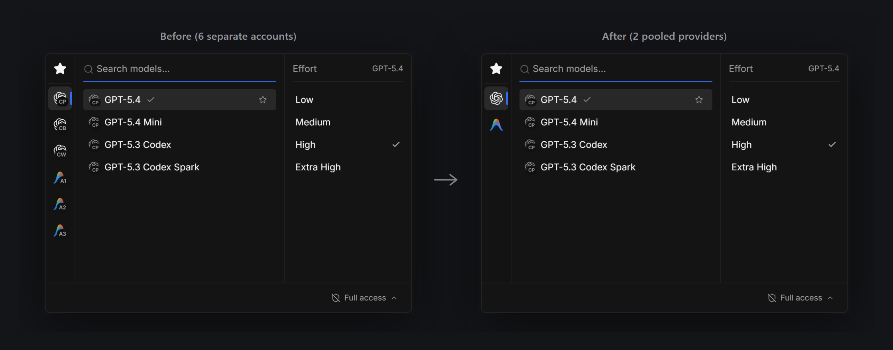
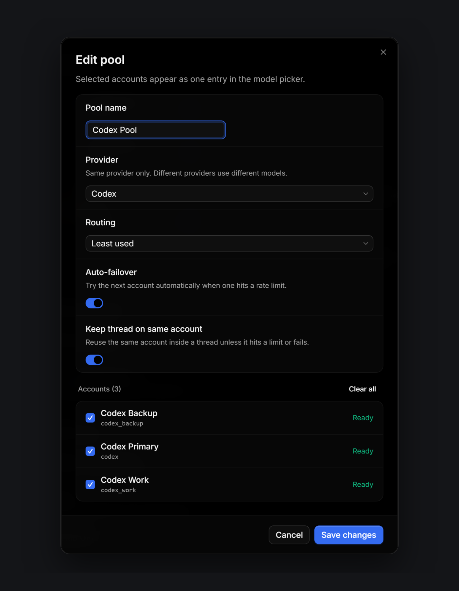
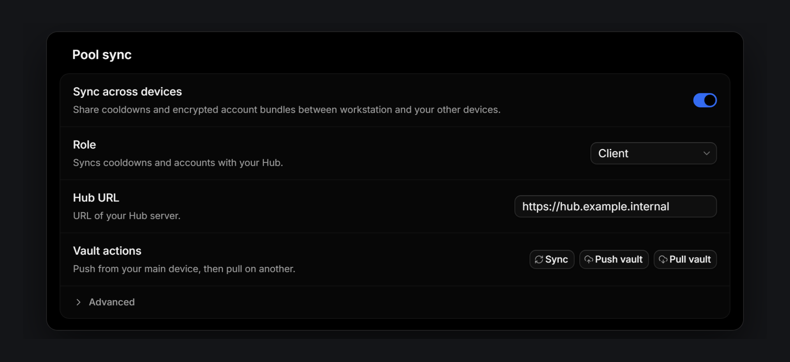

<h1 align="center">T3 Code Pool</h1>

  Fork of <a href="https://github.com/pingdotgg/t3code">T3 Code</a> with multi-account pools, automatic rate-limit failover, and device sync.

  <a href="https://github.com/S0yora/t3code-pool/releases"><strong>Releases</strong></a> |
  <a href="#how-it-works">How it works</a> |
  <a href="#device-sync">Device sync</a> |
  <a href="#install">Install</a> |
  <a href="./POOL.md">Technical notes</a>

  

## Why this fork exists

If you use multiple Codex, Antigravity, or Claude accounts, hitting a usage limit mid-thread means stopping, switching profiles by hand, and starting over.

T3 Code Pool groups accounts of the same provider into one pool. You pick one model in the chat selector, and T3 Code handles account selection and rate limits in the background. It runs on your own signed-in accounts, with no proxy or token reselling.

  

## How it works

Each pool sits in front of two or more accounts of the same provider (Codex, Antigravity, Claude, and others).

- **Routing strategy.** Choose how new threads pick an account: **Least used**, **Round robin**, or **Priority**.
- **Sticky threads.** A thread stays on the same account across turns so session state and context do not reset.
- **Auto-failover.** When an account hits a rate limit or quota error, it goes on cooldown and the turn automatically switches to the next ready account.
- **Clean picker.** Pooled accounts stay grouped in Settings and appear as a single entry in the chat model picker across desktop, web, and mobile.

  

## Device sync

If you run T3 Code on more than one machine, set one server (such as a Linux VM or home server) as a **Hub** and connect your laptops or desktops as **Clients**.

- **Shared cooldowns.** When an account hits a limit on one machine, the other machines know immediately and skip it.
- **Encrypted vault.** Push pools and optional credentials from your main machine and pull them on another. Bundles are encrypted with AES-256-GCM before leaving your device.
- **Cross-OS safe.** Pulling between Windows, macOS, and Linux keeps local binary and config paths intact instead of overwriting them with paths from another OS.

  

## Install

Download builds from [GitHub Releases](https://github.com/S0yora/t3code-pool/releases):

| Platform  | Available builds                                        |
| --------- | ------------------------------------------------------- |
| Windows   | `.exe` installer                                        |
| macOS     | `.dmg` (Apple Silicon and Intel)                        |
| Linux     | `.AppImage`, `.deb`, and standalone `t3` server binary  |
| Android   | Signed `T3-Code-*-android-arm64-v8a.apk`                |
| Web / iOS | Open your T3 Code server URL in a browser or iOS Safari |

## Quick setup

### Create a pool

1. Sign in to two or more accounts of the same provider in **Settings / Providers**.
2. Scroll to **Account pools**, click **Add pool**, pick a routing strategy, and select the accounts to include.
3. Choose the pool in the chat model picker.

### Sync across machines (optional)

1. On your server, open **Settings / Providers / Pool sync**, turn on **Sync across devices**, set **Role** to **Hub**, and set a sync token and vault passphrase under **Advanced**.
2. On your desktop or laptop, enable sync, set **Role** to **Client**, enter the **Hub URL**, and use the same token and passphrase.
3. Click **Push vault** on your main machine, then **Pull vault** on your other machines.

## More info

- [Technical notes and rebasing on upstream](./POOL.md)
- [Upstream T3 Code documentation](./docs/README.md)

 

   
  Fork of <a href="https://github.com/pingdotgg/t3code">pingdotgg/t3code</a>. Licensed under <a href="./LICENSE">MIT</a>.

